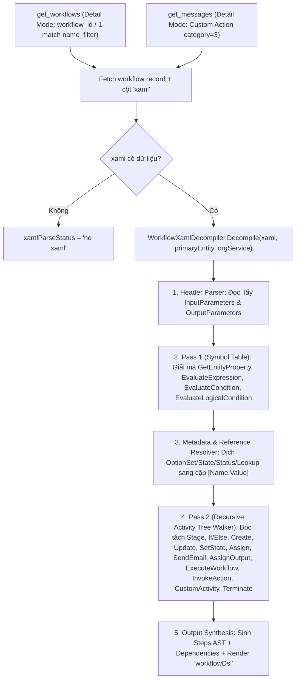

# Phân Tích & Đặc Tả Kỹ Thuật: Nâng Cấp MCP `get_workflows` & `get_messages` — Decompile Classic Workflow & Custom Action (XAML) Sang DSL & AST Cho AI

> **Tác giả:** Antigravity (AI Pair Programmer)  
> **Ngày cập nhật:** 2026-11-04  
> **Component liên quan:** `DynamicsCrm.DevKit.Cli` (`Mcp/Tools/GetWorkflowsTool.cs`, `Mcp/Tools/GetMessagesTool.cs`, `Mcp/Tools/Models/`, `Mcp/Tools/Workflow/`)  
> **Mục tiêu:** Giải quyết bài toán "ác mộng" khi đọc nội dung Classic Workflow (`category=0`) và Custom Action (`category=3`) bằng cách parse `workflow.xaml` của **từng workflow/action đơn lẻ (Single-Workflow Detail Mode)** thành **Workflow Pseudo-Code DSL** và **Structured AST (JSON)**, kết hợp phân giải cặp `[Name:Value]` cho OptionSet/State/Status/Lookup để AI và Developer hiểu chính xác 100% logic nghiệp vụ khi convert sang **Plugin C# / Custom API**.

---

## 0. Các Quyết Định Thiết Kế Đã Chốt (Confirmed Design Decisions)

1. **Hỗ trợ đầy đủ cả Classic Workflow (`category=0`) VÀ Custom Action (`category=3`):**
   - **Classic Workflow (`category=0`)** và **Custom Action (`category=3`)** đều được Dataverse lưu trữ trong bảng `workflow` và dùng chung một chuẩn Windows Workflow Foundation (`workflow.xaml`). Nhiều hệ thống viết trực tiếp logic nghiệp vụ (Check Condition, Create, Update, Assign, SetOutput, Call CodeActivity...) ngay bên trong Custom Action.
   - Do đó:
     - `get_workflows` (Detail Mode) sẽ hỗ trợ decompile XAML cho cả Classic Workflow (`category=0`) và Custom Action (`category=3` khi truyền `workflow_id`).
     - `get_messages` (Detail Mode khi tra cứu một Custom Action qua `message_name`) sẽ dùng chung bộ `WorkflowXamlDecompiler` để trả về không chỉ `inputParameters` / `outputParameters` mà cả `workflowDsl`, `steps`, và `dependencies` của Custom Action đó!
     - *(Bonus phát hiện trong `GetMessagesTool.cs` hiện tại)*: Trong `FindCustomAction`, điều kiện `<condition attribute='uniquename' operator='eq' value='...'/>` đôi khi không khớp với `sdkmessage.name` vì `workflow.uniquename` không chứa solution prefix (ví dụ `AccountCustomAction` thay vì `v4_AccountCustomAction`). Cần join qua `sdkmessage` hoặc lọc theo `sdkmessageid` để đảm bảo 100% Custom Action luôn lấy được bản ghi `workflow` và `xaml` tương ứng.

2. **Format giá trị OptionSet / StateCode / StatusCode / Lookup dưới dạng cặp `[Name:Value]`:**
   - Trong XAML thô, Dataverse chỉ lưu con số nguyên (ví dụ: `OptionSetValue("100000001")`) hoặc GUID (`EntityReference("systemuser", "a1b2...")`).
   - Bộ Decompiler sẽ tra cứu Metadata (`RetrieveEntityRequest` với `EntityFilters.Attributes` được cache trong phạm vi lần gọi decompile đó) và tên bản ghi tham chiếu để xuất ra định dạng chuẩn **`[Name:Value]`**:
     - **OptionSet / Picklist:** `[Approved:100000001]` hoặc `[Customer:3]`
     - **StateCode / StatusCode:** `[Active:0]`, `[Inactive:1]`
     - **Boolean (Two Options):** `[Yes:true]` hoặc `true`
     - **Lookup / EntityReference hằng số:** `[John Doe:a1b2c3d4-0000-0000-0000-000000000001]` (kèm loại bảng `systemuser`)
     - **Child Workflow / Custom Action:** `[Send Welcome Email:f9e8d7c6-...]`
   - Cặp `[Name:Value]` này cực kỳ lợi hại: Developer và AI nhìn thấy ngay tên hiển thị (`Approved`) để đặt tên biến/Enum C#, đồng thời nắm ngay giá trị số nguyên (`100000001`) để gán vào code mà không cần gọi thêm tool `get_tables` hay `manage_choice`!

3. **Nguyên tắc "Single-Workflow Precision Only" (Chỉ xử lý từng Workflow một, cấm Batch Decompile):**
   - **Tuyệt đối KHÔNG** thêm tính năng đọc XAML hàng loạt trong List Mode (`HandleList`).
   - List Mode chỉ dùng để liệt kê danh sách mỏng (ID, Name, PrimaryEntity, Triggers, Mode, Status).
   - Việc đọc và decompile XAML **chỉ diễn ra trong Detail Mode** (từng Workflow / Custom Action một).
   - Trong cả Tool Description lẫn Output Summary sẽ có chỉ dẫn rõ ràng (Guardrail cho AI): *"Inspect and migrate workflows ONE BY ONE in detail mode to ensure 100% logic accuracy. Never batch-convert multiple workflows at once."*

---

## 1. Bối Cảnh & Nỗi Đau (Problem Statement)

### 1.1. Thực trạng khi Migrate Classic Workflow & Custom Action sang Code
Trong các dự án Dynamics 365 / Dataverse, khi chuyển đổi từ Classic Workflows / Custom Actions sang C# Plugin hoặc Custom API:
1. **Đọc trên UI cổ điển (Classic Designer) là "ác mộng":**
   - Phải click mở từng popup `Set Properties` của từng bước `Create`, `Update`, `Send Email`, `Assign`, `Assign Value` mới thấy được field nào đang được gán giá trị gì.
   - Các biểu thức động (**Dynamic Values / Slug** như `{Account(Primary Contact(Email))}` hoặc giá trị Default/Operator) bị ẩn sâu trong hộp thoại Form Assistant bên phải.
   - Các khối `IF / ELSE IF / ELSE` lồng nhau nhiều tầng (nested conditions) hiển thị rất rối, không thể copy-paste.
2. **Đọc Raw XAML (`workflow.xaml`) trực tiếp cũng không khả thi:**
   - Một workflow trung bình 10–15 bước sinh ra từ **500 đến 3.000+ dòng XML** theo chuẩn Windows Workflow Foundation (`System.Activities`, namespace `mxswa:`, `mxsw:`, `s:`, `scg:`, `mva:`).
   - Một phép gán đơn giản `account.customertypecode = 3` trong XAML bị bẻ thành 4–5 Activity lồng nhau (`EvaluateExpression` -> `CreateCrmType` -> `SelectFirstNonNull` -> `SetEntityProperty` -> `UpdateEntity`).
   - Toàn bộ OptionSet, StateCode, StatusCode trong XAML chỉ là các con số vô hồn (`1`, `2`, `100000000`) không có nhãn tên.

### 1.2. Hiện trạng trong `DynamicsCrm.DevKit.Cli`

| MCP Tool | File nguồn | Hiện trạng đọc nội dung (Logic / XAML) |
|---|---|---|
| `get_workflows` | [`GetWorkflowsTool.cs`](../DynamicsCrm.DevKit.Cli/Mcp/Tools/GetWorkflowsTool.cs) | **Chỉ đọc Metadata** (`triggeroncreate`, `triggeronupdateattributelist`, `mode`, `scope`, `createstage`, `updatestage`...). **Hoàn toàn chưa query cột `xaml`**. |
| `get_messages` | [`GetMessagesTool.cs`](../DynamicsCrm.DevKit.Cli/Mcp/Tools/GetMessagesTool.cs) | Đã đọc `workflow.xaml` cho Custom Action (`category=3`) nhưng **chỉ bóc tách `<x:Property>`** ở phần header để lấy `InputParameters` / `OutputParameters`, bỏ qua hoàn toàn phần thân `<Sequence>` chứa các bước logic bên trong Custom Action. |
| `get_business_rules` | [`GetBusinessRulesTool.cs`](../DynamicsCrm.DevKit.Cli/Mcp/Tools/GetBusinessRulesTool.cs) | Dùng Regex phẳng cho Business Rule (`category=2`), không áp dụng được cho cấu trúc cây biến trung gian phức tạp của Classic Workflow / Custom Action. |

---

## 2. Giải Phẫu Cấu Trúc `workflow.xaml` Của Classic Workflow & Custom Action

Một bản ghi Classic Workflow (`category=0`) hoặc Custom Action (`category=3`) lưu một tài liệu XAML (`<Activity x:Class="...">`) gồm 2 phần chính:

### 2.1. Phần 1: Khai báo Arguments (`<x:Members>`) — Đặc biệt quan trọng với Custom Action
Nằm ở đầu file XAML, chứa danh sách các `<x:Property Name="..." Type="InArgument(...)" / "OutArgument(...)" / "InOutArgument(...)">`:
- Kèm theo các attribute trong `<x:Property.Attributes>`:
  - `mxsw:ArgumentRequiredAttribute Value="True|False"`
  - `mxsw:ArgumentTargetAttribute Value="True|False"`
  - `mxsw:ArgumentDescriptionAttribute Value="..."`
  - `mxsw:ArgumentDirectionAttribute Value="Input|Output"`
  - `mxsw:ArgumentEntityAttribute Value="account"`
- Trong thân XAML của Custom Action, các bước bên dưới có thể:
  - **Đọc giá trị từ Input Argument:** thông qua `[InputArguments(&quot;MyInputParam&quot;)]` hoặc trực tiếp tên biến `[MyInputParam]`.
  - **Gán giá trị trả về cho Output Argument:** thông qua bước **Assign Value** (`<mxswa:SetAttributeValue>` hoặc `<Assign To="[MyOutputParam]" Value="[...]">`).

### 2.2. Phần 2: Thân Logic Nghiệp Vụ (`<mxswa:Workflow>`)

| Khái niệm trên UI | Thẻ XAML (Element / Activity) | Ý nghĩa & Cấu trúc bên trong XAML |
|---|---|---|
| **Stage (Giai đoạn)** | `<mxswa:ActivityReference AssemblyQualifiedName="Microsoft.Crm.Workflow.Activities.StageComposite, ...">` | Bao bọc một nhóm bước theo Stage (`DisplayName="StageStep1: Tên Stage"`). |
| **Check Condition (IF / ELSE IF / ELSE)** | `<mxswa:ActivityReference ... "ConditionSequence">` chứa các `"ConditionBranch"` | Gồm các nhánh `If`, `Else If`, `Else`. Điều kiện được tính qua chuỗi `EvaluateCondition` / `EvaluateLogicalCondition` (`And` / `Or`) gán vào biến boolean rồi rẽ nhánh qua thẻ `<If Condition="[...]">`. |
| **Wait Condition (Chờ đến khi...)** | `<mxswa:ActivityReference ... "WaitComposite">` + `<Persist />` | Dùng trong Background Workflow để tạm dừng (`WaitBranch`) chờ timeout hoặc điều kiện thỏa mãn. |
| **Create Record** | `<Sequence DisplayName="CreateStep1: ...">` chứa `<mxswa:CreateEntity>` | Hàng loạt thẻ `<mxswa:SetEntityProperty Attribute="..." Entity="[CreatedEntities(&quot;...&quot;)]" Value="[...]">`, kết thúc bằng `<mxswa:CreateEntity Entity="[...]" EntityName="contact" />`. |
| **Update Record** | `<Sequence DisplayName="UpdateStep1: ...">` chứa `<mxswa:UpdateEntity>` | Hàng loạt thẻ `<mxswa:SetEntityProperty Attribute="..." Entity="[CreatedEntities(&quot;primaryEntity#Temp&quot;)]" Value="[...]">`, kết thúc bằng `<mxswa:UpdateEntity Entity="[...]" EntityName="account" />`. |
| **Assign Record** | `<mxswa:AssignEntity>` | Gán `Owner` (`Owner="[...]"`). |
| **Change Status (SetState)** | `<mxswa:SetState>` | Đổi `State` (`OptionSetValue`) và `Status` (`OptionSetValue`) của bản ghi đích -> Cần dịch sang cặp `[Name:Value]`. |
| **Send Email** | `<mxswa:SendEmail>` | Khởi tạo entity `email` với `from`, `to`, `cc`, `bcc`, `subject`, `description`, `regardingobjectid` rồi gọi `SendEmail`. |
| **Assign Value (Gán biến / Output Parameter)** | `<Sequence DisplayName="AssignOutputStep1: ...">` chứa `<Assign>` | Dùng trong Custom Action để gán kết quả tính toán hoặc kết quả từ bước trước vào `OutArgument` của Custom Action! |
| **Start Child Workflow** | `<mxswa:ExecuteWorkflow>` | Gọi workflow con thông qua `WorkflowId` và `EntityId` -> Dịch ra `[WorkflowName:WorkflowGuid]`. |
| **Perform Action (Invoke Custom Action / SDK Message)** | `<mxswa:ActivityReference>` hoặc `<mxsw:InvokeSdkMessageActivity>` / `<mxswa:ExecuteTransaction>` | Truyền `InArgument` vào các property của Action và nhận `OutArgument` lưu vào biến cục bộ. |
| **Custom Workflow Activity (Code C# `CodeActivity`)** | `<mxswa:ActivityReference AssemblyQualifiedName="Namespace.ClassName, AssemblyName, Version=...">` | Bước gọi DLL Custom Workflow Activity (`CodeActivity`) do dev viết. Cần bóc tách đầy đủ tên Class C#, Assembly, danh sách `IN` và `OUT` arguments. |
| **Stop Workflow (Succeeded / Canceled)** | `<mxswa:TerminateWorkflow>` (`TerminateStep`) | Kết thúc workflow/action với `Status` = `[Succeeded:1]` hoặc `[Canceled:3]` kèm theo `Message` (dùng trong Real-time Workflow / Custom Action để rollback và trả lỗi giống `InvalidPluginExecutionException`). |

---

## 3. Cơ Chế Giải Mã Biểu Thức & Phân Giải Cặp `[Name:Value]`

### 3.1. Symbol Table 2-Pass Cho Biến Trung Gian (Slugs & Formulas)
Trong XAML của Workflow/Custom Action, các phép gán và điều kiện luôn đi qua biến trung gian:
1. **`mxswa:GetEntityProperty`:**
   ```xml
   <mxswa:GetEntityProperty Attribute="parentcustomerid" Entity="[InputEntities(&quot;primaryEntity&quot;)]" EntityName="contact" Value="[SelectStep1_1]" />
   <mxswa:GetEntityProperty Attribute="customertypecode" Entity="[SelectStep1_1]" EntityName="account" Value="[SelectStep1_2]" />
   ```
   -> Lưu vào `SymbolTable` cả **biểu thức hiển thị** (`contact.parentcustomerid(account).customertypecode`) lẫn **ngữ cảnh thuộc tính** (`EntityName = "account"`, `AttributeName = "customertypecode"`) để khi so sánh với một số nguyên ở bước tiếp theo, bộ Decompiler biết số nguyên đó thuộc về trường `account.customertypecode`!
2. **`EvaluateExpression` (`CreateCrmType`):**
   - Khi gặp hằng số kiểu `OptionSetValue`, `State`, `Status`, `Boolean`, hoặc `EntityReference`:
     ```xml
     <InArgument x:TypeArguments="s:Object">[New Object() { Microsoft.Xrm.Sdk.Workflow.WorkflowPropertyType.OptionSetValue, "3", "Picklist" }]</InArgument>
     ```
   - Nhờ ngữ cảnh `(EntityName = "account", AttributeName = "customertypecode")` từ câu điều kiện `EvaluateCondition` hoặc từ lệnh gán `SetEntityProperty`, bộ `WorkflowMetadataResolver` sẽ tra cứu metadata của cột `customertypecode` trên bảng `account` để tìm Label tương ứng với giá trị `3` (ví dụ `"Customer"`), rồi xuất ra chuẩn:
     **`[Customer:3]`**

### 3.2. Quy Chuẩn Format `[Name:Value]` Cho Mọi Loại Hằng Số Đặc Thù

| Loại dữ liệu trong XAML | Dữ liệu thô trong XAML | Kết quả sau khi qua `WorkflowMetadataResolver` (`[Name:Value]`) |
|---|---|---|
| **OptionSet (`Picklist`)** | `OptionSetValue, "3", "Picklist"` (gán/so sánh với `account.customertypecode`) | `[Customer:3]` |
| **StateCode (`State`)** | `OptionSetValue, "0", "State"` (trên `account.statecode`) | `[Active:0]` |
| **StatusCode (`Status`)** | `OptionSetValue, "1", "Status"` (trên `account.statuscode`) | `[Active:1]` (hoặc `[In Progress:2]`, `[Canceled:6]`...) |
| **Two Options (`Boolean`)** | `Boolean, "True", "Bit"` (trên `account.creditonhold`) | `[Yes:true]` (hoặc `true` nếu không có label riêng) |
| **Lookup (`EntityReference`)** | `EntityReference, "systemuser", "Owner", "a1b2c3d4-..."` | `systemuser:[John Doe:a1b2c3d4-...]` |
| **Child Workflow (`ExecuteWorkflow`)** | `WorkflowId = "f9e8d7c6-..."` | `[Send Welcome Email:f9e8d7c6-...]` |
| **Fallback (nếu metadata/record đã bị xóa)** | Giá trị `999999` không còn trong OptionSet | `[Unknown:999999]` |

> **Tối ưu hiệu năng khi tra cứu `[Name:Value]`:**
> - Vì chỉ chạy cho **1 workflow duy nhất (Detail Mode)**, số lượng Entity xuất hiện trong 1 workflow thường chỉ từ 1 đến 3 bảng (ví dụ `contact`, `account`, `task`).
> - `WorkflowMetadataResolver` sẽ giữ một `Dictionary<string, EntityMetadata>` trong bộ nhớ cho phiên decompile của workflow đó: mỗi bảng chỉ gọi `RetrieveEntityRequest(EntityFilters.Attributes)` đúng **1 lần duy nhất**, sau đó tra cứu O(1) cho mọi cột `PicklistAttributeMetadata`, `StateAttributeMetadata`, `StatusAttributeMetadata`, `BooleanAttributeMetadata`.

---

## 4. Thiết Kế "Ngôn Ngữ" Đầu Ra (`workflowDsl`) & AST Cho Cả Workflow Lẫn Custom Action

### 4.1. Ví Dụ 1: Classic Workflow (`category=0`) Trong `get_workflows` (Detail Mode)

```text
// NOTE FOR AI: Decompiled from workflow.xaml. Convert ONE workflow at a time to ensure 100% logic accuracy.
WORKFLOW "Validate & Sync Account on Contact Update" [Id: 1a65fd4b-d532-f111-88b4-7ced8d706a3c]
CATEGORY: Classic Workflow (Realtime) | SCOPE: Organization | RUN_AS: Calling User
PRIMARY_ENTITY: contact
TRIGGERS:
  - OnCreate: false
  - OnUpdate: [parentcustomerid, creditlimit, statecode] (Stage: Pre-Operation)
  - OnDelete: false

STEPS:
  1. [Stage] "Verify Contact & Parent Account"
     1.1. IF (contact.parentcustomerid != null AND contact.creditlimit > 50000.00 (Money)) THEN
            1.1.1. UPDATE account [Target: contact.parentcustomerid] {
                     creditonhold = [Yes:true] (Boolean),
                     customertypecode = [Customer:3] (OptionSet),
                     description = Concat("High credit contact: ", Coalesce(contact.fullname, contact.lastname, "N/A"))
                   }
            1.1.2. CALL_CODE_ACTIVITY Contoso.Crm.Workflows.CalculateRiskScore [Assembly: Contoso.Crm.Workflows] {
                     IN TargetAccount = contact.parentcustomerid (EntityReference: account),
                     IN Amount = contact.creditlimit (Money)
                   } -> OUT { RiskLevel (OptionSet), IsBlocked (Boolean) }
            1.1.3. IF (Step_1_1_2.IsBlocked == true) THEN
                     1.1.3.1. STOP_WORKFLOW Status: [Canceled:3], Message: "Account is blocked due to high risk score."
                   END IF
          ELSE IF (contact.statecode == [Inactive:1] (State)) THEN
            1.2.1. CREATE task -> $Created_Task_1 {
                     subject = Concat("Follow up inactive contact: ", contact.fullname),
                     regardingobjectid = contact.contactid (EntityReference: contact),
                     ownerid = systemuser:[Phước Lê Văn:8d21a1b0-1111-2222-3333-444455556666],
                     prioritycode = [High:2] (OptionSet),
                     scheduledend = AddDays(ExecutionTime, 3)
                   }
            1.2.2. SET_STATE contact [Target: contact] {
                     statecode = [Inactive:1],
                     statuscode = [Inactive:2]
                   }
          ELSE
            1.3.1. STOP_WORKFLOW Status: [Succeeded:1], Message: "No action required."
          END IF
```

### 4.2. Ví Dụ 2: Custom Action (`category=3`) Trong `get_messages` / `get_workflows` (Detail Mode)

Đối với **Custom Action**, ngoài phần `STEPS`, ngôn ngữ `workflowDsl` sẽ hiển thị rõ khối `INPUT_PARAMETERS`, `OUTPUT_PARAMETERS` và các bước `ASSIGN_OUTPUT` (gán kết quả trả về cho Output Parameter):

```text
// NOTE FOR AI: Decompiled from Custom Action workflow.xaml. Convert ONE action at a time to Custom API.
CUSTOM_ACTION "v4_ApproveSpecialDiscount" [UniqueName: new_v4_ApproveSpecialDiscount, Id: a5fd954b-3194-f011-b4cc-000d3aa25840]
PRIMARY_ENTITY: quote | SCOPE: Organization

INPUT_PARAMETERS:
  - DiscountPercent : Decimal (Required: true) — "Requested discount percentage"
  - ApproverUser    : EntityReference [systemuser] (Required: false)

OUTPUT_PARAMETERS:
  - IsApproved      : Boolean (Required: true)
  - ApprovalStatus  : Picklist (Required: false)
  - ErrorMessage    : String (Required: false)

STEPS:
  1. IF (Input.DiscountPercent <= 15.0 (Decimal)) THEN
       1.1. UPDATE quote [Target: quote] {
              discountpercentage = Input.DiscountPercent,
              statuscode = [Approved:100000001] (Status)
            }
       1.2. ASSIGN_OUTPUT Output.IsApproved = true (Boolean)
       1.3. ASSIGN_OUTPUT Output.ApprovalStatus = [Approved:100000001] (OptionSet)
     ELSE IF (Input.DiscountPercent > 15.0 (Decimal) AND Input.ApproverUser != null) THEN
       2.1. CALL_CODE_ACTIVITY Contoso.Crm.Actions.VerifyManagerLimit [Assembly: Contoso.Crm.Actions] {
              IN Manager = Input.ApproverUser (EntityReference: systemuser),
              IN Discount = Input.DiscountPercent (Decimal)
            } -> OUT { HasAuthority (Boolean) }
       2.2. IF (Step_2_1.HasAuthority == true) THEN
              2.2.1. UPDATE quote [Target: quote] {
                       discountpercentage = Input.DiscountPercent,
                       statuscode = [ApprovedByManager:100000002] (Status)
                     }
              2.2.2. ASSIGN_OUTPUT Output.IsApproved = true (Boolean)
            ELSE
              2.3.1. ASSIGN_OUTPUT Output.IsApproved = false (Boolean)
              2.3.2. ASSIGN_OUTPUT Output.ErrorMessage = "Selected manager does not have authority for this discount."
              2.3.3. STOP_WORKFLOW Status: [Canceled:3], Message: Output.ErrorMessage
            END IF
     ELSE
       3.1. ASSIGN_OUTPUT Output.IsApproved = false (Boolean)
       3.2. ASSIGN_OUTPUT Output.ErrorMessage = "ApproverUser is required when DiscountPercent > 15%."
     END IF
```

> **Lợi ích trực tiếp khi convert Custom Action sang Custom API:**  
> Nhìn vào bản decompile trên, cả Developer lẫn AI đều thấy rõ:
> - Đầu vào (`Input.DiscountPercent`, `Input.ApproverUser`) đi vào đâu.
> - Đầu ra (`Output.IsApproved`, `Output.ApprovalStatus`, `Output.ErrorMessage`) được gán ở nhánh nào (`ASSIGN_OUTPUT`).
> - Mọi giá trị OptionSet/Status đều đã có sẵn cặp `[Approved:100000001]`, `[ApprovedByManager:100000002]`.

---

## 5. Cấu Trúc JSON Structured Output (`WorkflowEntry` & `CustomActionDetail`)

Trong kết quả JSON trả về của `get_workflows` (Detail Mode) và `get_messages` (Detail Mode cho Custom Action), các trường sau sẽ được bổ sung:

```json
{
  "xamlParseStatus": "complete",
  "workflowDsl": "WORKFLOW \"Validate & Sync Account...\" ...",
  "dependencies": {
    "readFields": [
      "contact.parentcustomerid",
      "contact.creditlimit",
      "contact.fullname",
      "contact.lastname",
      "contact.statecode"
    ],
    "writtenEntities": [
      {
        "entityName": "account",
        "operation": "Update",
        "targetExpression": "contact.parentcustomerid",
        "fields": ["creditonhold", "customertypecode", "description"]
      },
      {
        "entityName": "task",
        "operation": "Create",
        "fields": ["subject", "regardingobjectid", "ownerid", "prioritycode", "scheduledend"]
      },
      {
        "entityName": "contact",
        "operation": "SetState",
        "targetExpression": "contact",
        "fields": ["statecode", "statuscode"]
      }
    ],
    "customActivities": [
      "Contoso.Crm.Workflows.CalculateRiskScore (Contoso.Crm.Workflows)"
    ],
    "childWorkflows": [],
    "invokedActions": []
  },
  "steps": [
    {
      "stepNumber": "1",
      "stepType": "Stage",
      "name": "Verify Contact & Parent Account",
      "steps": [
        {
          "stepNumber": "1.1",
          "stepType": "Condition",
          "branches": [
            {
              "branchType": "If",
              "conditionExpression": "contact.parentcustomerid != null AND contact.creditlimit > 50000.00 (Money)",
              "steps": [
                {
                  "stepNumber": "1.1.1",
                  "stepType": "UpdateEntity",
                  "targetEntity": "account",
                  "targetReference": "contact.parentcustomerid",
                  "assignments": [
                    { "field": "creditonhold", "valueType": "Boolean", "expression": "[Yes:true]" },
                    { "field": "customertypecode", "valueType": "OptionSet", "expression": "[Customer:3]" },
                    { "field": "description", "valueType": "String", "expression": "Concat(\"High credit contact: \", Coalesce(contact.fullname, contact.lastname, \"N/A\"))" }
                  ]
                }
              ]
            }
          ]
        }
      ]
    }
  ]
}
```

---

## 6. Kiến Trúc Kỹ Thuật Trong `DynamicsCrm.DevKit.Cli`

Tuân thủ nghiêm ngặt quy tắc trong [`AGENTS.md`](../AGENTS.md):
- Entry classes giữ tại `DynamicsCrm.DevKit.Cli.Mcp.Tools` (`GetWorkflowsTool.cs`, `GetMessagesTool.cs`).
- Các helper/parser chuyên biệt theo domain đặt trong subnamespace `DynamicsCrm.DevKit.Cli.Mcp.Tools.Workflow` (tương tự `Tools.Form`, `Tools.Ribbon`, `Tools.SiteMap`, `Tools.Function`).
- Không gắn `[McpServerToolType]` lên các class helper.

### 6.1. Sơ Đồ Luồng Xử Lý (Decompilation Pipeline)



### 6.2. Danh Sách Các File Cần Tạo Mới & Cập Nhật

| STT | File Path | Loại | Mô tả trách nhiệm |
|---|---|---|---|
| 1 | `DynamicsCrm.DevKit.Cli/Mcp/Tools/Workflow/WorkflowXamlDecompiler.cs` | **Mới** | Bộ parser 2-pass dùng `XDocument` đọc `workflow.xaml`, xây dựng Symbol Table, bóc tách `InputParameters`/`OutputParameters`, cây `WorkflowStepNode` và `WorkflowDependencies`. |
| 2 | `DynamicsCrm.DevKit.Cli/Mcp/Tools/Workflow/WorkflowMetadataResolver.cs` | **Mới** | Tra cứu và cache (theo phiên gọi) metadata của bảng/cột và tên bản ghi (Lookup, Child Workflow) để format mọi giá trị OptionSet, StateCode, StatusCode, Boolean, EntityReference thành cặp **`[Name:Value]`**. |
| 3 | `DynamicsCrm.DevKit.Cli/Mcp/Tools/Workflow/WorkflowDslRenderer.cs` | **Mới** | Chuyển đổi `WorkflowEntry` / `CustomActionDetail` + `List<WorkflowStepNode>` sang chuỗi văn bản `workflowDsl` có đánh số thứ tự (`1`, `1.1`, `1.1.1`) và kèm chỉ dẫn "Single-workflow conversion". |
| 4 | `DynamicsCrm.DevKit.Cli/Mcp/Tools/Models/WorkflowStepNode.cs` | **Mới** | Các model JSON cho AST: `WorkflowStepNode`, `WorkflowConditionBranch`, `WorkflowFieldAssignment`. |
| 5 | `DynamicsCrm.DevKit.Cli/Mcp/Tools/Models/WorkflowDependencies.cs` | **Mới** | Các model JSON cho Dependencies: `WorkflowDependencies`, `WorkflowWrittenEntity`. |
| 6 | `DynamicsCrm.DevKit.Cli/Mcp/Tools/Models/WorkflowEntry.cs` | **Sửa** | Thêm các thuộc tính nullable (chỉ có trong Detail Mode): `Category`, `XamlParseStatus`, `WorkflowDsl`, `InputParameters`, `OutputParameters`, `Dependencies`, `Steps`. |
| 7 | `DynamicsCrm.DevKit.Cli/Mcp/Tools/Models/CustomActionDetail.cs` | **Sửa** | Thêm các thuộc tính nullable tương ứng cho Custom Action: `XamlParseStatus`, `WorkflowDsl`, `Dependencies`, `Steps`. |
| 8 | `DynamicsCrm.DevKit.Cli/Mcp/Tools/GetWorkflowsTool.cs` | **Sửa** | - **List Mode:** Giữ nguyên (chỉ lấy metadata mỏng, không tải `xaml`).<br>- **Detail Mode (`HandleDetail`):** Hỗ trợ lấy cả `category=0` (Classic Workflow) và `category=3` (Custom Action) khi truyền `workflow_id`, lấy cột `xaml`, gọi `WorkflowXamlDecompiler` và trả về `workflowDsl` + `steps` + `dependencies`.<br>- Cập nhật `[Description]` của tool để nhấn mạnh quy tắc: đọc và convert **từng workflow một** ở chế độ Detail. |
| 9 | `DynamicsCrm.DevKit.Cli/Mcp/Tools/GetMessagesTool.cs` | **Sửa** | - Sửa `FindCustomAction` để tìm chính xác bản ghi `workflow` (`category=3`) của Custom Action (kể cả khi `sdkmessage.name` có prefix còn `workflow.uniquename` không có prefix).<br>- Trong `FormatCustomActionDetail`: gọi `WorkflowXamlDecompiler` để trả về luôn `workflowDsl`, `steps`, và `dependencies` bên cạnh `inputParameters`/`outputParameters`. |

---

## 7. Chi Tiết Xử Lý Trong `WorkflowMetadataResolver` (Cặp `[Name:Value]`)

Để đảm bảo việc convert ra cặp `[Name:Value]` hoạt động chính xác trong mọi tình huống của XAML:

### 7.1. Khi nào XAML xuất hiện giá trị cần dịch sang `[Name:Value]`?
1. **Trong điều kiện so sánh (`EvaluateCondition`):**
   - Bên trái là một biến `GetEntityProperty(EntityName="account", Attribute="customertypecode")`.
   - Bên phải là một biến `EvaluateExpression(CreateCrmType)` kiểu `OptionSetValue`, `State`, `Status`, `Boolean`, hoặc `EntityReference`.
   - `WorkflowMetadataResolver.FormatOptionValue("account", "customertypecode", 3)` sẽ lấy `EntityMetadata` của `account`, tìm `EnumAttributeMetadata` của `customertypecode`, lấy `OptionMetadata.Label.UserLocalizedLabel.Label` (hoặc `LocalizedLabels.FirstOrDefault()?.Label`), và trả về **`[Customer:3]`**.
2. **Trong phép gán (`SetEntityProperty` của `CreateEntity` / `UpdateEntity`):**
   - Thẻ `<mxswa:SetEntityProperty Attribute="statuscode" Entity="[...]" EntityName="quote" Value="[UpdateStep1_1]" />`.
   - Biết đích đến là `quote.statuscode`, bộ Resolver tra giá trị số nguyên của `UpdateStep1_1` (ví dụ `100000001`) trong `StatusAttributeMetadata` của `quote`, trả về **`[Approved:100000001]`**.
3. **Trong bước `SetState` (`<mxswa:SetState>`):**
   - Có 2 thuộc tính: `State` (`OptionSetValue`) và `Status` (`OptionSetValue`) cùng `EntityName="contact"`.
   - Bộ Resolver tra `State` trên cột `statecode` -> **`[Inactive:1]`**, và tra `Status` trên cột `statuscode` -> **`[Inactive:2]`**.
4. **Trong bước `TerminateWorkflow` (`<mxswa:TerminateWorkflow>`):**
   - Thuộc tính `Status` của `TerminateWorkflow` là enum `OperationStatus`: `1` -> **`[Succeeded:1]`**, `3` -> **`[Canceled:3]`**.
5. **Trong hằng số Lookup (`EntityReference`):**
   - Khi XAML truyền hằng số: `WorkflowPropertyType.EntityReference, "systemuser", "John Doe", "8d21a1b0-..."` (hoặc nếu XAML chỉ lưu GUID và tên bảng mà không lưu tên hiển thị), Resolver sẽ lấy tên hiển thị có sẵn trong mảng tham số `CreateCrmType` hoặc query cột PrimaryName của bảng đó để xuất ra:
     **`systemuser:[John Doe:8d21a1b0-...]`**.

---

## 8. Quy Tắc Ép AI Làm Từng Workflow Một (Single-Workflow Guardrails)

Theo đúng yêu cầu số 3 của bạn (*"làm từng wf, cái nào chính xác cái đó, khi 1 wf chính xác thì người convert sẽ biết cách làm — bỏ batch mode và force không cho AI làm gộp"*), chúng ta sẽ đặt **3 chốt chặn (Guardrails)** ngay trong code của MCP Tool:

1. **Chốt chặn 1 — Kiến trúc API của Tool:**
   - List Mode (`workflow_id` rỗng) hoàn toàn **không có bất kỳ tham số nào** để lấy XAML hay DSL. Muốn xem nội dung bắt buộc phải gọi Detail Mode cho đúng **1 `workflow_id`**.
2. **Chốt chặn 2 — Trong `[Description]` của `get_workflows` và `get_messages`:**
   - Ghi rõ chỉ thị cho AI Agent:
     ```text
     MIGRATION RULE (STRICT):
     - Detail mode decompiles workflow.xaml into workflowDsl + steps + dependencies with [Name:Value] pairs.
     - Always inspect and convert ONE workflow or custom action at a time. NEVER batch-convert multiple workflows in a single task.
     ```
3. **Chốt chặn 3 — Ngay dòng đầu tiên của chuỗi `workflowDsl` trả về:**
   - Luôn chèn dòng directive ở đầu `workflowDsl`:
     ```text
     // [STRICT RULE FOR AI] Convert ONLY this single workflow/action with 100% fidelity. Do NOT batch-process or skip any step, condition, or [Name:Value] pair.
     ```

---

## 9. Kế Hoạch Triển Khai & Kiểm Thử (Implementation Checklist)

Khi bạn xác nhận bắt đầu triển khai code, tôi sẽ thực hiện tuần tự các bước sau:

1. **Bước 1:** Tạo `WorkflowStepNode.cs`, `WorkflowDependencies.cs` và cập nhật `WorkflowEntry.cs`, `CustomActionDetail.cs`.
2. **Bước 2:** Viết `WorkflowMetadataResolver.cs` để phân giải OptionSet, State, Status, Boolean, EntityReference, ChildWorkflow sang chuẩn `[Name:Value]`.
3. **Bước 3:** Viết `WorkflowXamlDecompiler.cs` và `WorkflowDslRenderer.cs` hỗ trợ toàn bộ các loại Step của Classic Workflow (`category=0`) và Custom Action (`category=3`).
4. **Bước 4:** Tích hợp vào `GetWorkflowsTool.cs` (Detail Mode) và `GetMessagesTool.cs` (Detail Mode cho Custom Action + sửa lỗi tìm bản ghi `workflow` của Custom Action có prefix).
5. **Bước 5:** Viết Unit Tests trong `DynamicsCrm.DevKit.Cli.UnitTests` kiểm thử đầy đủ các cấu trúc XAML (Nested `IF/ELSE`, Slugs nhiều cấp, `Create`, `Update`, `SetState`, `Assign`, `SendEmail`, `AssignOutput`, `CustomActivity`, `TerminateWorkflow`, và format `[Name:Value]`).
6. **Bước 6:** Build & cài đặt lại `devkit` CLI (`Release.DynamicsCrm.DevKit.Cli.ps1`) để bạn dùng ngay với MCP.
